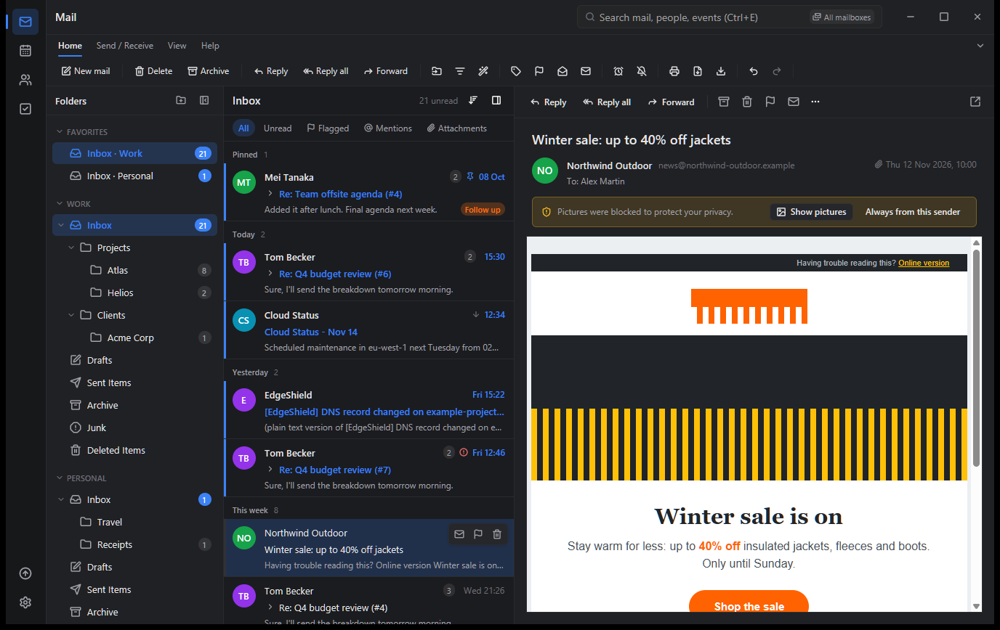

<div align="center">


# Mailbox

**Mail, calendar, contacts and tasks in one fast, native desktop app.**

Written in Rust with [GPUI](https://github.com/zed-industries/zed/tree/main/crates/gpui), the GPU
UI framework behind the Zed editor. No Electron, and your data stays on your computer.

[Download the latest release](https://github.com/0XLUC4/MailBox/releases/latest)

</div>



<sub>Screenshot taken with demo data (made-up people and messages).</sub>

## Features

- **Mail**: any IMAP / SMTP provider (Gmail, Outlook, iCloud, your own domain…), automatic server
  detection, folders and favorites, conversations, advanced search (`from:`, `has:attachment`,
  `is:unread`, `after:`…), flags, categories, rules, snooze, send later, offline mode.
- **Emails shown exactly as they were sent**, rendered by the Windows WebView2 engine and locked
  down: JavaScript off, remote images blocked until you allow them.
- **Compose**: rich text, attachments, signatures, auto-saved drafts, undo send, several compose
  windows at once.
- **Calendar**: day, week, month and agenda views, recurring events, reminders, multiple calendars,
  invitations (accept / decline), `.ics` import and export, CalDAV sync.
- **Contacts**: full contact cards, groups, duplicate merging, `.vcf` import and export, CardDAV sync.
- **Tasks**: My Day, Important, Planned, custom lists, steps, reminders, flagged emails.
- **Built-in updates**: the arrow above Settings shows when a new version is out, then
  "Update and restart".
- Light / dark theme, accent color, English and French UI, undo / redo everywhere
  (`Ctrl+Z` / `Ctrl+Shift+Z`).

## Install (Windows)

1. Download `Mailbox-X.Y.Z-windows-x64.exe` from the
   [releases](https://github.com/0XLUC4/MailBox/releases/latest).
2. Put it anywhere and run it. No installer, nothing to unzip.
3. Add your account: email address and password. For Gmail, use an
   [app password](https://myaccount.google.com/apppasswords).

Your mail is stored in `%APPDATA%\Mailbox` and your password in the Windows Credential Manager.

## Build from source

Requires a recent stable [Rust](https://rustup.rs) toolchain.

```sh
cargo run -p mailbox                      # run the app
cargo run -p mailbox -- --data ./test.db  # use another database
cargo test --workspace                    # run all tests
```

Portable package:

```powershell
cargo build --release -p mailbox
powershell -ExecutionPolicy Bypass -File scripts\package.ps1   # dist\Mailbox-<version>-windows-x64.exe + dist\latest.json
```

## Releasing

Bump `version` in `[workspace.package]` (`Cargo.toml`), commit, then:

```sh
git tag -a vX.Y.Z -m "What changed" && git push origin vX.Y.Z
```

`.github/workflows/release.yml` builds on Windows and publishes the release with two assets:
`Mailbox-X.Y.Z-windows-x64.exe` and `latest.json` (version, date, notes from an annotated tag's
message, plus the exe's URL, SHA-256 and size under `platforms.windows-x86_64`). The app reads
`https://github.com/0XLUC4/MailBox/releases/latest/download/latest.json` 10 seconds after start and
every 6 hours (a plain download, not the rate-limited GitHub API). "Update and restart" downloads the
exe next to the running one, checks its size and SHA-256, swaps it in (the previous exe is kept as
`<name>.old.exe` until the next start), relaunches, and rolls back if anything fails.

The same workflow builds macOS Apple Silicon (M1 to M5) on a macOS runner
(`scripts/package-macos.sh`): `Mailbox-X.Y.Z-macos-arm64.dmg` to install and
`Mailbox-X.Y.Z-macos-arm64.app.tar.gz`, listed under `platforms.darwin-aarch64` in `latest.json`:
"Update and restart" swaps the running `Mailbox.app` (kept as `Mailbox.old.app` until the next
start). Not notarized: the first launch needs right-click > Open. It is signed with the
self-signed certificate in the `MACOS_CERT_P12` / `MACOS_CERT_PASSWORD` secrets (ad hoc without
them): the same signature on every release keeps the Keychain's "Always Allow" across updates.
Linux: `Mailbox-X.Y.Z-linux-x64.tar.gz` (`scripts/package-linux.sh`: the binary, a `.desktop`
entry and the icon), listed under `platforms.linux-x86_64` in `latest.json`: "Update and restart"
swaps the running binary (kept as `mailbox.old.exe` until the next start, so its folder must be
writable). A final job publishes
all packages and `latest.json` together. Run the workflow by hand (Actions > release > Run
workflow) to build everything as workflow artifacts without publishing anything.

## Project layout

| Folder | Purpose |
|---|---|
| `crates/core` | Data model, SQLite store, undoable commands |
| `crates/sync` | IMAP / SMTP, OAuth2, CalDAV / CardDAV, `.eml` / `.mbox` |
| `crates/ui` | The GPUI application |
| `crates/updater` | Updates from GitHub releases |
| `crates/devserver` | Local fake IMAP / SMTP server for tests |
| `apps/mailbox` | The executable (embedded Windows icon) |
| `assets` | Icon (SVG, PNG, ICO) |

See [ARCHITECTURE.md](ARCHITECTURE.md) for details.
